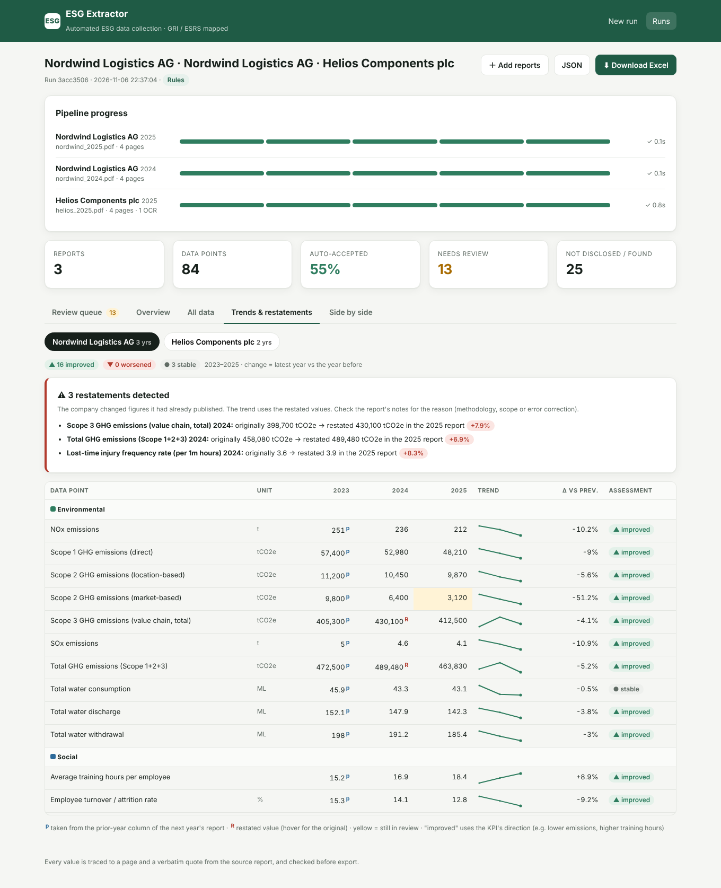
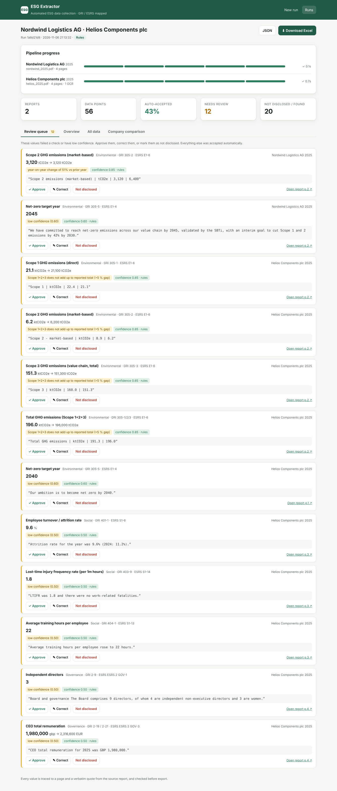
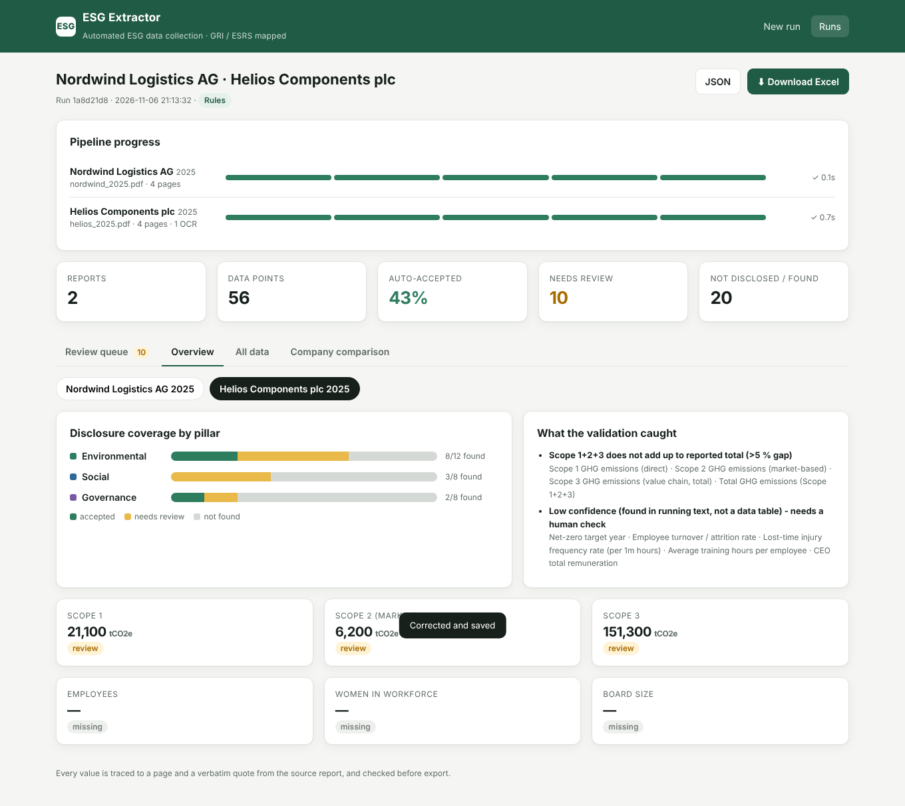

# ESG Extractor

**Automated ESG data collection from corporate sustainability and annual reports, with every number traceable to its page and checked before it reaches the dataset.**

ESG research teams spend most of their time on one manual loop: open a 150-page report, find ~30 KPIs (Scope 1/2/3, water, workforce, board), copy them into a template, convert units, check them. This project automates that loop end to end. It keeps a human in charge of the uncertain cases.



> **Status:** working prototype and personal portfolio project, built with Claude as a coding partner. The free rule-based mode is tuned on the bundled (fictional) sample reports. On real 100+ page annual reports it finds fewer values, but anything doubtful goes to the review queue instead of being accepted. The **Hybrid** mode (rules + Claude) is the intended setup for real reports.

```
 sources.csv ─► 1 COLLECT ─► 2 PARSE ─► 3 LOCATE ─► 4 EXTRACT ─► 5 VALIDATE ─► 6 REVIEW QUEUE ─► 7 EXPORT
  (URLs)        download     text +      BM25 page   rules and/or   units, evidence,  only flagged     Excel + JSON
                PDFs         tables +    ranking     Claude (LLM)   cross-field       fields go to a   (GRI/ESRS-
                             OCR         per field   with citations accounting rules  human            mapped)
```

## What it extracts
28 data points across E, S and G. Each one is mapped to the **GRI Standards** and **ESRS (CSRD)** disclosure it comes from ([`config/schema.yaml`](config/schema.yaml)):

| | Data points |
|---|---|
| **E** | Scope 1, Scope 2 (location & market), Scope 3, total GHG (GRI 305) · NOx, SOx (305-7) · water withdrawal / discharge / consumption (303-3/4/5) · net-zero target year · environmental policy |
| **S** | headcount (2-7) · % women (405-1) · turnover, new hires (401-1) · LTIFR, fatalities (403-9) · training hours (404-1) · human-rights policy |
| **G** | board size, independent directors, women on board (2-9, 405-1) · CEO/Chair separation (2-11) · CEO pay (2-21) · board committees · corruption incidents (205-3) · whistleblower mechanism (2-26) |

To add a data point, add an entry to the YAML. No code changes needed.

## Design decisions
- **Every value carries a page number and a verbatim evidence quote.** The validator checks that the quote *and* the number really appear on the cited page. This catches LLM hallucinations (tested in `tests/`).
- **The model never calculates.** It copies what's printed, or returns "not found". Sums it computed itself couldn't be audited.
- **Accounting rules a human analyst would apply:** Scope 1+2+3 = total (±5 %). Withdrawal − discharge ≈ consumption. Independent directors ≤ board size. Percentages within 0–100. Year-on-year jumps over 50 %.
- **Unit normalisation:** tCO2e / ktCO2e / MtCO2e, m³ / KL / ML / million m³ / gallons, EUR / GBP / USD / INR (incl. crore/lakh). Ambiguous units like `mtCO2e` are sent to review rather than guessed.
- **Status per value:** `accepted` · `review` · `missing`. The key metric is **silent errors**: wrong values that were auto-accepted. A wrong value in the review queue costs a minute. A silent one corrupts the dataset.
- **Three extractor modes:** `rules` (free, deterministic baseline), `llm` (Claude, tool-use JSON), and `hybrid` (rules first, LLM only for what rules missed or doubted, which cuts API cost).

## Dashboard
A web app that runs the whole process end to end: upload reports, run, review, export.

```bash
pip install -r requirements.txt
python app/server.py                 # → http://localhost:8000
# optional, enables Hybrid / Claude modes:
export ANTHROPIC_API_KEY=...  &&  python app/server.py
```

| Screen | What it shows |
|---|---|
| **New run** | Drop PDFs (company and year guessed from the file name, editable), pick Rules / Hybrid / Claude, run. Or **Try with sample reports** for a one-click demo. |
| **Pipeline progress** | Live, stage-by-stage progress per report (parse → locate → extract → validate), with page and OCR counts |
| **Review queue** | Only flagged values, each with the reason, a verbatim source quote and an *Open report p.X* link. **Approve / Correct / Not disclosed**, with every decision logged. |
| **Overview** | Disclosure coverage per E/S/G pillar, what the validation caught, headline KPIs |
| **All data** | Every data point with GRI code, reported and normalised value, page, confidence; click a row for the evidence |
| **Trends & restatements** | Multi-year view per company: value per year, sparkline, change vs prior year, and whether that's an *improvement* given the KPI's direction (lower emissions, higher training hours). Uses the prior-year column, so **one report already gives two years**. Flags **restatements**: figures the company changed after publishing them. |
| **Side by side** | All reports side by side in one unit per KPI |
| **＋ Add reports** | Add earlier years (or other companies) to an existing run; only the new reports are processed |
| **Export** | Excel (Summary, ESG_Data, Company_View, Review_Queue, Trends, Restatements) or JSON, reviewer edits included |




**Deploy for a shareable link:** the repo includes a `Dockerfile` (RapidOCR built in) and a `Procfile`. Push to GitHub and create a Web Service on Render or Railway. Set `ANTHROPIC_API_KEY` as an environment variable if you want Claude enabled. Runs are stored on local disk, which is fine for demos. Use a persistent volume for anything longer-lived.

## Quick start (command line)
```bash
pip install -r requirements.txt          # includes RapidOCR for scanned pages - nothing else to install
python samples/make_samples.py           # two fictional test reports
python -m esg_pipeline run --manifest samples/manifest.csv --extractor rules --out output/esg_rules.xlsx
python eval/run_eval.py output/esg_rules.json
pytest -q
```

With Claude:
```bash
export ANTHROPIC_API_KEY=...
python -m esg_pipeline run --manifest samples/manifest.csv --extractor hybrid --out output/esg_hybrid.xlsx
python eval/run_eval.py output/esg_rules.json output/esg_hybrid.json      # compare baseline vs LLM
```

Real reports:
```bash
# sources.csv: company,year,url   (direct PDF links from investor-relations pages)
python -m esg_pipeline collect --sources sources.csv --out reports/
python -m esg_pipeline run --manifest reports/manifest.csv --extractor hybrid --out output/esg.xlsx
```

## Output workbook
| Sheet | Contents |
|---|---|
| Summary | accepted / review / missing per company, auto-accept rate |
| ESG_Data | one row per data point: reported value and unit, normalised value, page, evidence, confidence, issues, GRI/ESRS code (colour-coded by status) |
| Company_View | one row per company, one column per KPI (normalised), ready for analysis |
| Review_Queue | only the values a human needs to check, with the reason |

## Test reports & evaluation
`samples/` holds two **fictional** reports. They are built to reproduce real-world messiness:
- Year columns in reverse order (`2024 | 2025`), so the extractor has to read headers, not positions
- Mixed units (ktCO2e vs tCO2e, ML vs m³, GBP vs EUR thousand)
- Distractor numbers in prose ("cut Scope 1 by 42 % by 2030")
- A Scope total that deliberately **doesn't add up**. The right result is to extract it as reported *and* flag it.
- A governance page that is a **scanned image**. It's read by built-in OCR (RapidOCR, or Tesseract if installed), and OCR'd numbers always go to review because OCR can drop decimal points.
- Nordwind **2024 and 2025** reports, where the 2025 report **restates** 2024 Scope 3 and LTIFR. The trend view finds all three changed figures and builds a 2023–2025 series from two reports.

Rule-based baseline on these (84 data points, 3 reports):

| Metric | Rules baseline |
|---|---|
| Accuracy | 74 % |
| Auto-accepted | 55 % |
| Wrong values | 1 (sent to review) |
| **Silent errors** | **0** |

The rules baseline is strong on clean tables. It misses prose and qualitative fields (policies, CEO/Chair split), which is the gap the LLM mode covers. Run the eval with `--extractor llm` or `hybrid` to measure that.

## Project layout
```
config/schema.yaml        data-point definitions (GRI/ESRS mapped)
esg_pipeline/
  collect.py              1 download PDFs + manifest
  parse.py                2 pdfplumber text + tables, OCR fallback
  locate.py               3 BM25 page ranking per field
  extract_rules.py        4 regex/table baseline
  extract_llm.py          4 Claude tool-use extractor with citations
  normalize.py            5 number parsing + unit conversion
  validate.py             5 evidence check, field rules, cross-field rules, status
  trends.py               multi-year series, change/direction, restatement detection
  export.py               7 Excel + JSON
  pipeline.py, __main__.py  orchestration + CLI
app/server.py, templates/  Flask dashboard (upload, run, review, export)
Dockerfile, Procfile      deployment
eval/                     gold labels + scoring (accuracy, silent errors)
samples/                  fictional test-report generator
tests/                    pytest, incl. a fake-LLM hallucination test
```

## Limitations / next steps
- Rules mode needs more label/unit variants for real annual reports (units in table headings, labels like "Number of employees"); Hybrid mode covers this today.
- Scope 3 is extracted as a total; per-category (1–15) breakdown would be the next schema extension.
- FX rates in `normalize.py` are illustrative. Plug in year-average rates for real comparisons.
- User accounts and a database behind the dashboard.
- Evaluate on a labelled set of real public reports (e.g. 10 DAX companies) to report LLM accuracy and cost per report.
